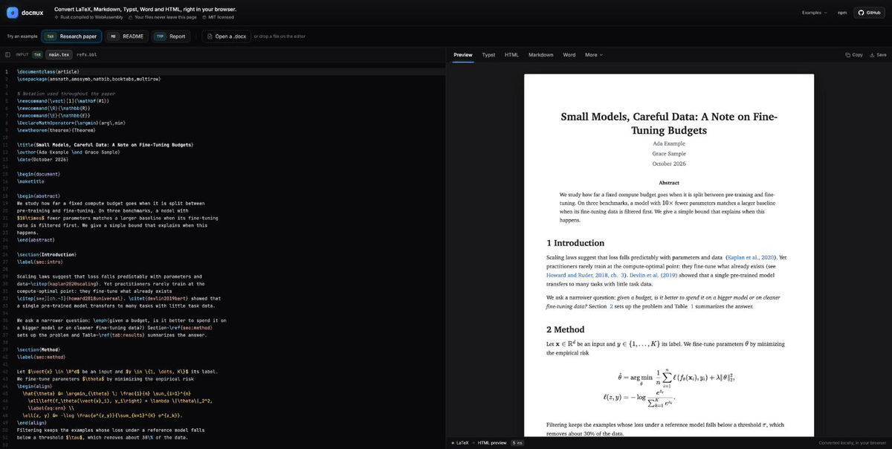

# docmux

Convert LaTeX, Markdown, Typst, Word, HTML and MyST in the browser, in Node or from the command line. MIT licensed, written in Rust and compiled to WebAssembly.

**[Try it in the playground](https://docmux.pages.dev/playground/)**: a research paper is already loaded, and nothing leaves your browser.



## What is docmux?

docmux converts between markup formats with a **Reader → AST → Writer** pipeline. Each format is a separate Rust crate, so a WASM build only carries what it uses. It covers a part of what Pandoc does, under the MIT license, and it is meant to be embedded in web applications.

## Tested on real papers

Unit tests pass long before real documents do, so docmux is also checked against the LaTeX sources of real arXiv papers, 245 so far and counting, written between 1998 and 2025. Some are well known, from machine learning (Transformer, GPT-3, ResNet) to mathematics (Perelman's Ricci flow, Viazovska's sphere packing), physics (the CMS Higgs observation) and astronomy (Planck 2018); most are a random sample from across arXiv. The Typst output of all 245 compiles with no errors and no leftover LaTeX commands, and their Word output carries 108,734 equations as native Word math, read back independently with pandoc. The harness lives in [`scripts/corpus/`](scripts/corpus/); the sources are downloaded, not committed.

## Supported formats

| Format | Reader | Writer |
|--------|--------|--------|
| Markdown (CommonMark + GFM) | ✅ | ✅ |
| HTML5 | ✅ | ✅ |
| LaTeX | ✅ | ✅ |
| Typst | ✅ | ✅ |
| MyST Markdown | ✅ | ✅ |
| DOCX | ✅ | ✅ |
| Plaintext | ❌ | ✅ |

## Quick start

### CLI

```bash
# Install from source
cargo install --path crates/docmux-cli

# Convert Markdown to HTML
docmux input.md -o output.html

# Standalone HTML with math support
docmux paper.md -o paper.html --standalone --math=katex

# LaTeX to Typst
docmux paper.tex -t typst -o paper.typ

# DOCX to Markdown
docmux report.docx -o report.md

# Dump AST as JSON
docmux input.md -t json
```

### JavaScript / WASM

```bash
npm install @docmux/wasm
```

```typescript
import { convert, convertStandalone } from "@docmux/wasm";

const result = await convert("# Hello\n\nWorld!", "markdown", "html");
if (result.error) {
  console.error(result.error);
} else {
  console.log(result.output); // <h1 id="hello">1 Hello</h1>\n<p>World!</p>\n
}
```

For Vite or vanilla JS without bundler plugins, use the web target:

```typescript
import init, { convert } from "@docmux/wasm/web";

await init();
const html = convert("# Hello", "markdown", "html");
```

### Multi-file LaTeX (`\input` / `\include`)

For LaTeX papers that split their body across multiple files, pass a `files`
map alongside the main source:

```js
import init, { convertWithFiles } from '@docmux/wasm/web';
await init();

const files = new Map([
  ['intro.tex', new TextEncoder().encode(introSource)],
  ['body.tex', new TextEncoder().encode(bodySource)],
]);

const md = convertWithFiles(
  mainTex,
  'latex',
  'markdown',
  files,
  new Map(), // resources (images), empty if none
  false,     // standalone
);
```

`\input{intro}` resolves against `intro.tex` (the `.tex` extension is added
automatically if the bare key is missing). The CLI does the same thing
automatically when you point it at a single `.tex` file on disk:

```sh
docmux paper/main.tex --to markdown
```

See the [@docmux/wasm README](npm/README.md) for full API documentation.

### Rust library

```rust
use docmux_reader_markdown::MarkdownReader;
use docmux_writer_html::HtmlWriter;
use docmux_core::{Reader, Writer, WriteOptions};

let reader = MarkdownReader::new();
let writer = HtmlWriter::new();

let doc = reader.read("# Hello\n\nWorld!")?;
let html = writer.write(&doc, &WriteOptions::default())?;
```

## Features

- **13+ block types, 16+ inline types**: math, citations, cross-references, admonitions, tables, footnotes
- **LaTeX as people write it**: user macros (`\newcommand`, `\def`, `\DeclareMathOperator`) are expanded, layout commands keep their text, and `\input` files are followed
- **Citations from the `.bbl`** that arXiv ships: numeric, alphabetic or author-year, each linked to its reference
- **Math across formats**: LaTeX to Typst math, MathML or KaTeX for HTML, and native Word equations (OMML) for DOCX
- **Syntax highlighting** via syntect (HTML and LaTeX output)
- **Template engine**: pandoc-compatible `$variable$` syntax with conditionals and loops
- **Transforms**: table of contents, section numbering, cross-reference resolution, CSL citations, math notation conversion, section divs
- **Image embedding**: real dimension parsing (PNG/JPEG), drag-and-drop in playground, resource-aware DOCX writer
- **CLI parity**: `--standalone`, `--toc`, `--number-sections`, `--template`, `--bibliography`, `--csl`, `--math`, `--css`, `--wrap`, and more

## Architecture

```
Input → Reader → [Document AST] → Transforms → Writer → Output
```

The AST is format-agnostic: N readers × M writers give N×M conversions without N×M converters. Each reader, writer, and transform is a separate crate under `crates/`.

## Contributing

Contributions are welcome! Here's how to get started:

### Prerequisites

- [Rust](https://rustup.rs/) (latest stable)
- [wasm-pack](https://rustwasm.github.io/wasm-pack/installer/) (for WASM builds)
- [Node.js](https://nodejs.org/) 18+ and [pnpm](https://pnpm.io/) (for the playground and npm package)

### Build and test

```bash
# Rust workspace
cargo check --workspace
cargo test --workspace
cargo clippy --workspace --all-targets -- -D warnings
cargo fmt --all -- --check

# WASM build
cargo build --target wasm32-unknown-unknown -p docmux-wasm

# npm package
cd npm && pnpm install && pnpm run build && node test.mjs

# Playground
cd playground && pnpm install && pnpm run dev
```

### Code style

- No `unwrap()` in library code: use `?` and proper error types
- No `any` in TypeScript: use interfaces, generics, discriminated unions
- New functionality must have tests
- Run `cargo fmt` and `cargo clippy` before committing

### Submitting changes

1. Fork the repo and create a branch
2. Make your changes with tests
3. Ensure all checks pass: `cargo test --workspace && cargo clippy --workspace --all-targets -- -D warnings`
4. Open a pull request with a clear description

## License

MIT, see [LICENSE](LICENSE).
